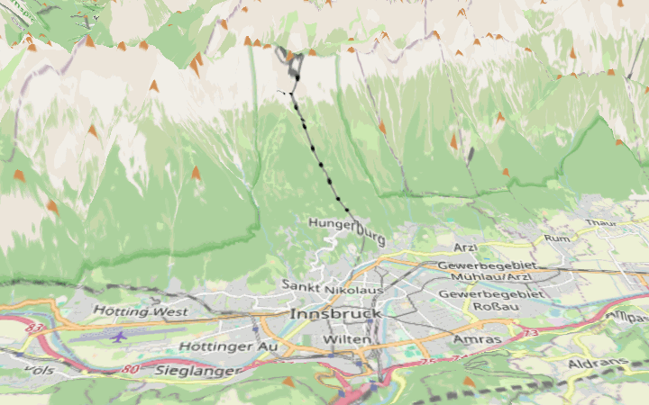
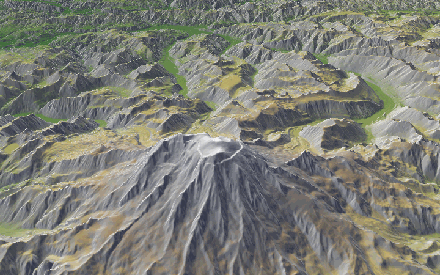
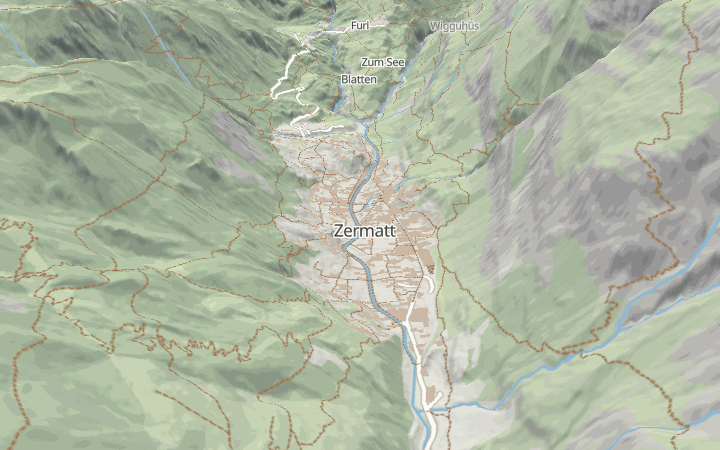
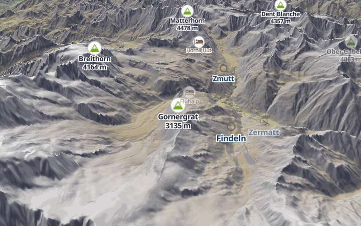
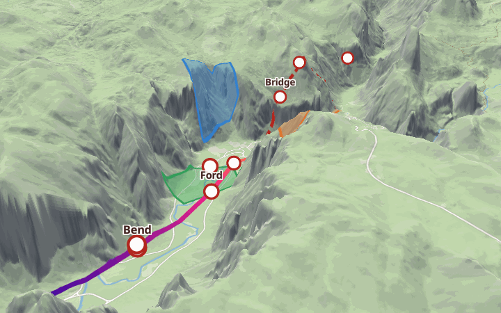
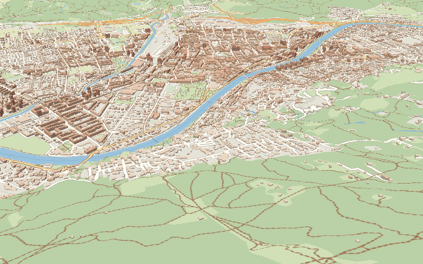
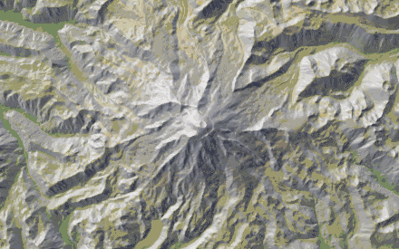

# 3D terrain examples

Seven small examples for the 3D terrain on the `feature/terrain-3d` branch of MapLibre Native.
Each one is a single style JSON plus a camera. Everything uses public data with no API key, and every
style loads straight from a local file (`file://`).

| # | Style | Shows |
|---|---|---|
| 1 | `styles/01-basic-terrain.json` | A raster basemap draped over terrain, vertical exaggeration 2 |
| 2 | `styles/02-hillshade-color-relief.json` | Hillshade and color-relief sharing one `raster-dem` source with the terrain |
| 3 | `styles/03-vector-basemap.json` | A full vector basemap (landcover, water, roads, flat buildings, labels) draped |
| 4 | `styles/04-symbols.json` | Peak, hut and place symbols that stand on the ground and fade out behind ridges |
| 5 | `styles/05-overlays.json` | Transparent fills with outlines, a dashed route, a gradient route and waypoint circles |
| 6 | `styles/06-buildings.json` | Fill-extrusion buildings in a city, raised onto the relief |
| 7 | `tour.txt` + `tour.sh` | A scripted camera tour with pitch and bearing changes |

The camera for each example (center, zoom, pitch, bearing, center altitude) is in `cameras.txt`.
The shapes in example 5 and the points in example 4 are inline GeoJSON written for this kit. The routes and
areas are made up. The peak, hut and place positions are approximate.

## 1. Basic terrain



OpenStreetMap raster tiles draped over Mapterhorn elevation, exaggeration 2. Innsbruck sits in the Inn
valley with the Nordkette rising behind it. The terrain needs only a `raster-dem` source and a `terrain`
object. The raster layer is draped automatically:

```json
"terrain": { "source": "dem", "exaggeration": 2.0 }
```

## 2. Hillshade and color-relief



One source, `dem`, feeds three things: the terrain mesh, a `color-relief` layer (a hypsometric ramp keyed on
`["elevation"]`) and a `hillshade` layer. The branch shares the decoded DEM between them, so the tiles are
downloaded once. Mount Rainier.

## 3. Vector basemap



OpenFreeMap vector tiles (OpenMapTiles schema) drawn flat and draped: landcover, parks, water, roads with
casings, footpaths, building footprints and place labels, plus a faint hillshade so the relief reads under
the flat colors. Zermatt below the Matterhorn. Place labels are point symbols. The style has no labels along
lines, because TERRAIN.md lists elevation for line-placed labels as not done.

## 4. Symbols on terrain



Three symbol layers read one GeoJSON source: peaks (the `mountain` sprite icon, name and height), huts and
places. The icons and text are lifted to the ground height under them, and a label whose anchor falls behind
a ridge fades out (Zermatt and Ober Gabelhorn are partly faded here). Matterhorn and Monte Rosa seen from
the east.

## 5. Overlays and transparency



Over a draped vector basemap: three semi-transparent `fill` polygons, each with a wider `line` outline; a
dashed route (`line-dasharray`); a second route colored along its length with `line-gradient` (the source
sets `lineMetrics: true`); and `circle` layers at waypoints with `symbol` labels. Fills and lines are
rendered into the terrain tiles, so they follow the ground. Circles and labels are elevated, so they sit on
it. Yosemite Valley.

## 6. Buildings on relief



`fill-extrusion` buildings from the OpenFreeMap `building` layer, colored by height, in Innsbruck with the
Nordkette slope in the foreground. Each building is raised by the ground height at its center.

Extrusion height on terrain is OpenGL and WebGPU only so far, according to TERRAIN.md. (Its backend table
also records Vulkan and Metal fixes, but marks the Metal one as awaiting CI.) Only OpenGL was tried for this
kit. `run.sh` prints a reminder when you open this example on macOS with Metal.

## 7. Camera tour



`tour.txt` lists camera stops around Mount Rainier. `tour.sh` interpolates between them (eased, bearing the
short way around), looks up the ground height under every frame's center from the same public elevation
tiles, renders each frame with `mbgl-render`, and stitches the frames into a GIF: with `ffmpeg` when it is
installed, otherwise with Pillow. It also estimates where the camera itself is, and stops if the camera would
come closer than 120 m to the terrain; the lowest clearance is printed.

## Running

You need a build of MapLibre Native from the `feature/terrain-3d` branch (or a branch made from it).
From the repository root:

```sh
examples/terrain-3d/run.sh 3            # example by number, or by name: run.sh vector-basemap
```

* **Linux:** `run.sh` builds `mbgl-glfw` with the `linux-opengl` CMake preset if it is not built yet
  (`cmake --preset linux-opengl && cmake --build build-linux-opengl --target mbgl-glfw`), then opens the
  example. Set `MBGL_GLFW` to use a binary from another build directory.
* **macOS:** `run.sh` runs `bazel run --//:renderer=metal //platform/glfw:glfw_app -- ...`, as in
  `docs/mdbook/src/platforms/macos/README.md`. Set `RENDERER=opengl` to try another renderer.

Both pass `--maxPitch 85` so you can tilt past the default 60 degrees. In the viewer, drag to pan, use the
wheel to zoom, and drag with the right mouse button (or hold Ctrl) to rotate and tilt.

To render every example to a PNG (also needs `mbgl-render`, built with
`cmake --build build-linux-opengl --target mbgl-render`):

```sh
examples/terrain-3d/render-previews.sh          # all, into previews/
examples/terrain-3d/render-previews.sh 3 5      # only these
examples/terrain-3d/tour.sh                     # the GIF
```

On a headless Linux machine the scripts start `xvfb-run` themselves when there is no display. Software
OpenGL works but is slow: about a minute per image on a cold cache and a few seconds when the tiles are
already in the cache file. The tour GIF is about 1.5 MB. Set `MBGL_RENDER` to point at a `mbgl-render` binary elsewhere, and `CACHE` to
choose the tile cache file. Previews are written as 256-color PNGs when Pillow is installed so each stays
under about 300 KB.

### Notes on single-frame renders

* **The center altitude is part of the camera.** A running map moves its center up onto the terrain after
  the first frame. `mbgl-render` draws only one frame, so the camera would sit as if the ground were at sea
  level, much too low. `cameras.txt` therefore carries the ground height under the center, multiplied by the
  style's exaggeration, and the scripts pass it as `--alt`. Without it the still is not blank but the view
  is from the wrong place. `lib/ground_elevation.py LON LAT` prints the ground height for any point.
* **Tiles load before the image is taken.** Rendering with an empty cache and again with a warm one gave
  identical images, so no second pass is needed. When a tile request fails, `mbgl-render` can exit without
  an image (the OpenFreeMap host occasionally resets a connection). The scripts simply try again; the tiles
  fetched so far are already cached.
* **`mbgl-render` limits pitch to 60 degrees.** The interactive viewer can go higher with `--maxPitch`.
* **Single-frame renders only.** The tour moves the camera by rendering separate frames, not by animating
  one map.

## Known limits seen while making this

* Circles and extrusions that read the ground height drew in some zoom ranges and not in others on the build
  tested (commit `9ee438b`, OpenGL). The vector-tile buildings in example 6 drew between zoom 14.0 and about
  14.5 and not at 13.8, 14.6 or 15.2, although they draw with terrain off. The waypoint circles in example 5
  drew at zoom 12.0 and not at 11.7. The examples are framed inside the working ranges. A look at
  `RenderTerrain::getTerrainData` suggests the cause: it only finds a DEM tile that is the layer's tile or
  an ancestor of it, so a layer tile coarser than the loaded DEM tiles gets the placeholder (all zeros,
  which Terrarium reads as -32768 m). That is a reading of the code, not something we confirmed.
* TERRAIN.md lists antialiasing for draped gradient, pattern and dashed lines as unfinished, so the route
  edges in example 5 can look a little different from the same lines undraped.
* `run.sh` was run on Linux under a virtual X display (`xvfb-run`, software OpenGL), where `mbgl-glfw`
  accepted every option and drew examples 5 and 6 (the framebuffer was captured and looked at). No mouse or
  keyboard input was tried, and macOS with Bazel was not run at all.
* `tour.sh` used the Pillow fallback here. The `ffmpeg` branch is standard `palettegen`/`paletteuse` but has
  not been run.

Not used, because TERRAIN.md marks them unfinished or non-draped: heatmaps, custom layers, pattern fills
and `fill-extrusion-pattern`, and labels along lines.

## Data and attribution

No key or account is needed. Please keep your use light; these are free community services.

* **Elevation:** [Mapterhorn](https://mapterhorn.com/attribution), worldwide, Terrarium encoding, 512 px
  tiles, via `https://tiles.mapterhorn.com/tilejson.json`. The tile JSON gives the encoding and tile size.
  Credit: "&copy; Mapterhorn" with the link above.
* **Vector tiles, fonts and icons:** [OpenFreeMap](https://openfreemap.org) (`https://tiles.openfreemap.org/planet`,
  OpenMapTiles schema), glyphs from `https://tiles.openfreemap.org/fonts/{fontstack}/{range}.pbf` and the
  sprite from `https://tiles.openfreemap.org/sprites/ofm_f384/ofm` (the sprite path was read from
  `https://tiles.openfreemap.org/styles/liberty` on 2026-11-12; it is versioned, so check it if icons go
  missing). Credit: OpenFreeMap, &copy; OpenMapTiles, data from OpenStreetMap.
* **Raster tiles (example 1 only):** `tile.openstreetmap.org`. Credit: &copy; OpenStreetMap contributors.
  The OpenStreetMap
  [tile usage policy](https://operations.osmfoundation.org/policies/tiles/) forbids heavy use and
  bulk downloading. Example 1 is the only one that uses it, and a render fetches about 25 tiles. Do not
  point this kit at it for bulk work; use your own tile server or another provider for that.
* **GeoJSON:** written for this kit, with made-up routes and areas near famous public mountain places (the
  Matterhorn and Zermatt, Innsbruck, Yosemite Valley, Mount Rainier). Peak, hut and town positions are
  approximate. Nothing in it comes from a survey or a trail database.

The styles and GeoJSON in this folder are original to this kit and fall under the repository's license.
Every source carries its attribution text in its `attribution` field, so a viewer that shows attribution
will credit them.
