# Terrain 3D for iOS

A small SwiftUI iPhone app that shows what the 3D terrain of the `feature/terrain-3d` branch of MapLibre Native
can do on iOS. Pick a demo from the **Demos** menu and the app moves the camera and switches on the layers that
demo needs. The scene is mostly the Matterhorn and Zermatt. Everything uses public data with no API key.

| 2D | 3D |
|---|---|
| 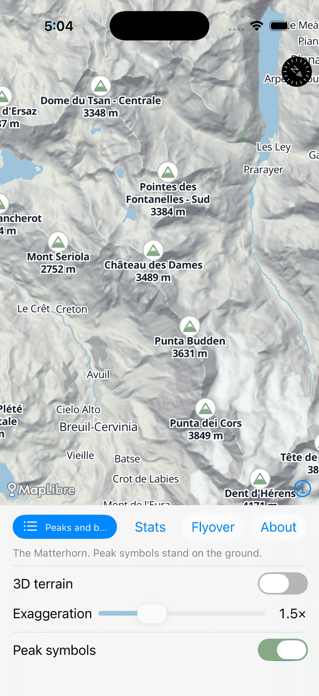 |  |

The first demo, **Peaks and basemap**, is the base of the app:

* **2D and 3D.** The switch sets `MLNStyle.terrain` and tilts the camera between 0 and 60 degrees.
  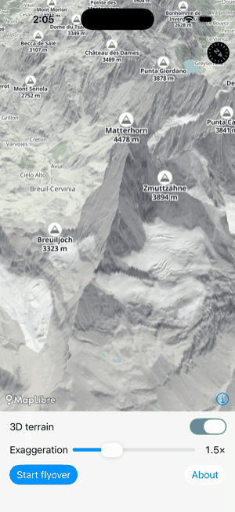
* **Exaggeration.** A slider sets the vertical exaggeration, 0.5 to 4.
* **Basemap and peaks.** The OpenFreeMap vector basemap (land cover, water, roads with casings, paths,
  buildings, place labels) is draped on the terrain, and peak symbols with name and height stand on the ground.
* **Taps.** `visibleFeatures(at:)` gives the name and class of a peak or road, and
  `MLNMapView.terrainElevation(at:)` the ground height. The call returns the height as drawn, so the app divides the
  exaggeration out and shows both.
* **Flyover.** A button runs a scripted camera tour down the Mattertal toward Täsch and back.
  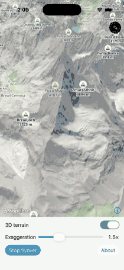

| Exaggeration 3.5 | Tap on a peak | Tap on a road |
|---|---|---|
|  | 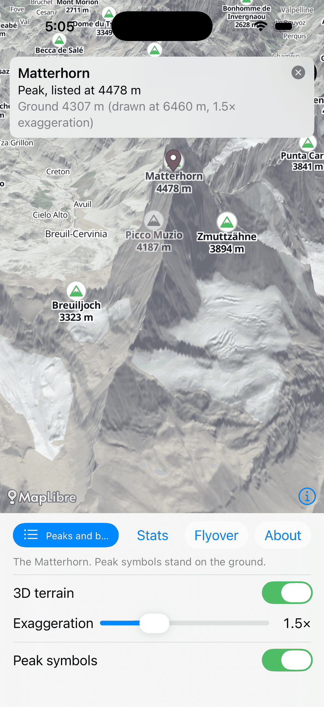 |  |

| About | Attribution button |
|---|---|
| 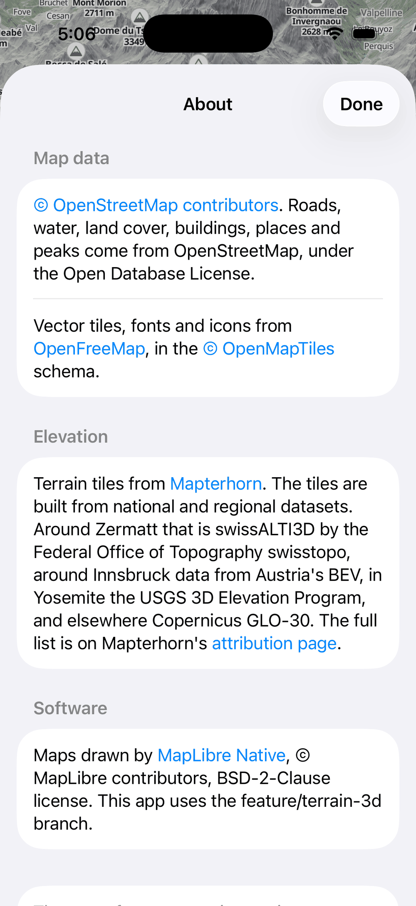 | 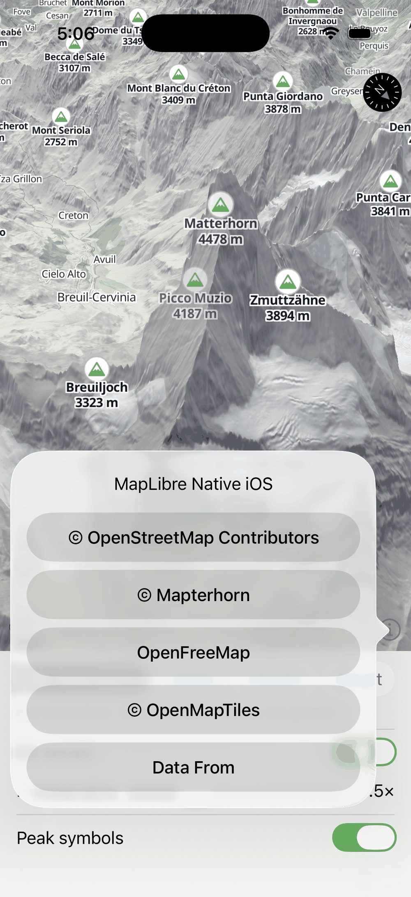 |

## The demos

All demos share one `raster-dem` source, `dem`, for the terrain, the hillshade and the color relief.

### 1. Hillshade and color relief
Mount Rainier. Toggles for the `hillshade` and `color-relief` layers, a slider for the hillshade strength, all fed
by the terrain's own DEM source. 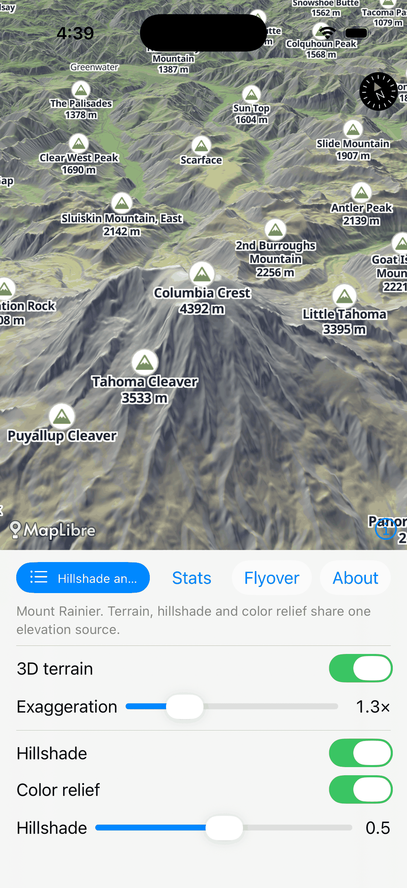

### 2. 3D buildings
Innsbruck below the Nordkette. A `fill-extrusion` layer on the OpenFreeMap `building` layer, with each building
raised by the ground height at its center. TERRAIN.md lists Metal as awaiting CI confirmation for this. It drew on
the iOS simulator, on the Hungerburg slope as well as in the valley. 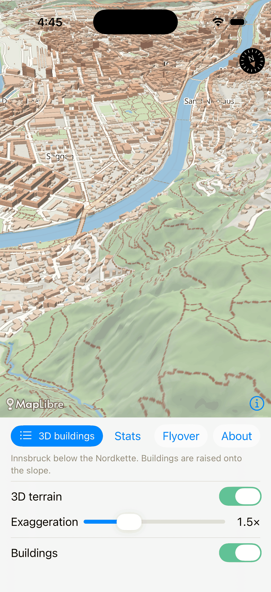

### 3. Draped overlays
Yosemite Valley. Semi-transparent GeoJSON fills with outlines, a dashed route, a route colored along its length with
`line-gradient`, and waypoint circles with labels. The fills and lines are drawn into the terrain and follow
the ground, and the circles and labels sit on it. These shapes are **made up** for this example, taken from the kit's
example 5. They are not real zones, routes or trails. 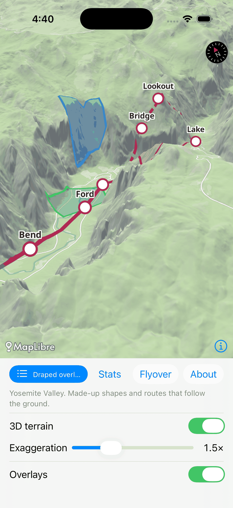

### 4. Labels behind ridges
Peak and place symbols are lifted to the ground, and TERRAIN.md says a symbol whose anchor falls behind a ridge fades
out. The button sweeps the view so ridges pass in front of labels.
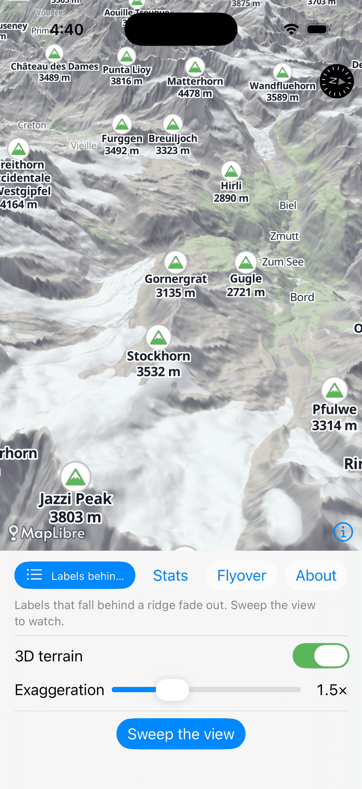
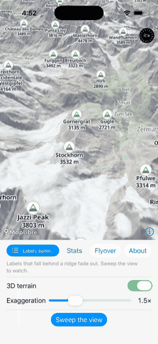

### 5. Heatmap and circles
OpenStreetMap peaks as a `heatmap` layer, as `circle` layers, or both. TERRAIN.md says a circle or heatmap kernel
whose center is behind terrain is hidden, and that the heatmap's color pass still draws over everything else. In the
pictures the markers sit on the far slopes and none is drawn over the near ridge, but this app does not test the
claim against a peak known to be hidden. 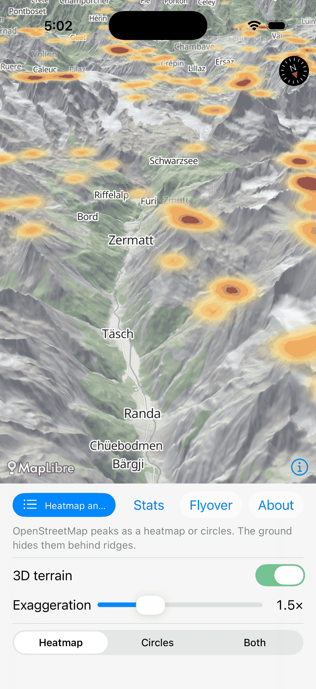
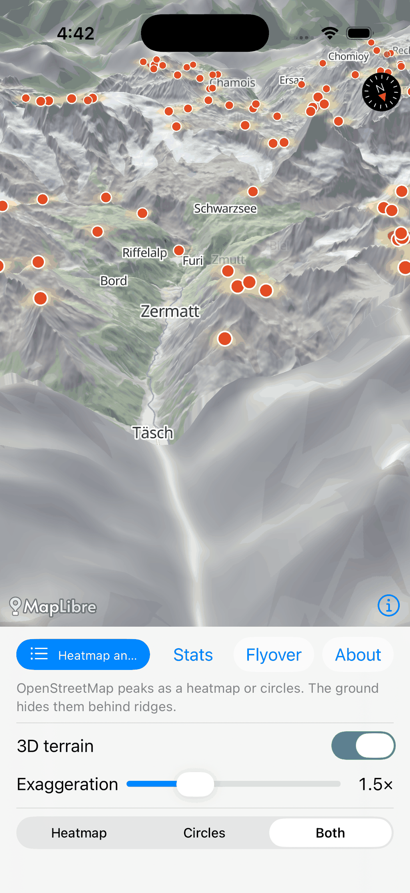

### 6. Sky and skirts
The basemap fills and background are hidden, so the map is transparent and a SwiftUI gradient shows through behind
it, under the translucent hillshade. A control switches `terrainSkirtLength` between Auto and None. In this view
the two looked the same: a pixel comparison of two screenshots found 9 differing pixels. The skirts matter at tile
seams, and the view here has none that show, so a camera that shows the difference was not found. The map view's
pitch is limited to 60 degrees, so the sky only shows through the map, not above a horizon.
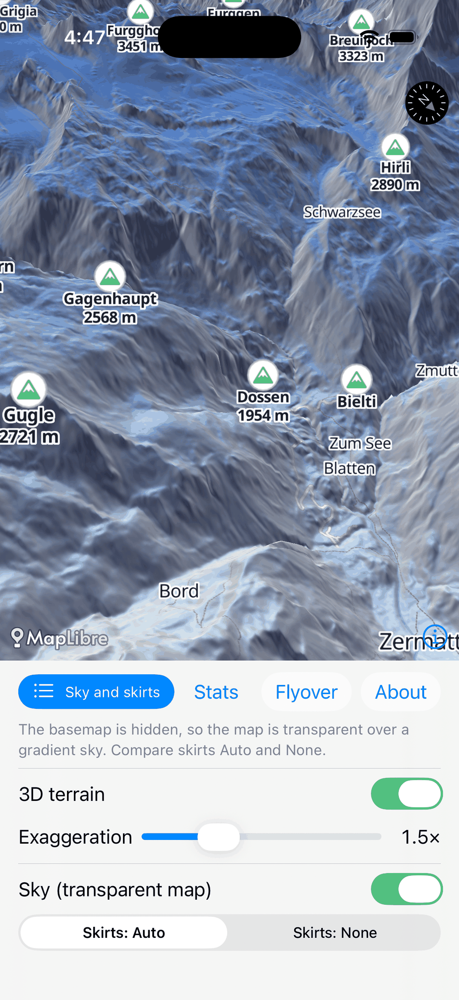

### 7 and 10. Load modes and the stats overlay
A picker for `MLNTerrainLoadMode` (Quality, Balanced, Performance) and a button that moves the camera over new
ground so tiles load. The **Stats** button, available in every demo, shows a small overlay from
`MLNRenderingStats`: frames per second as counted by `numFrames`, draw calls in the last frame, drape targets and
tile builds the load budget deferred, terrain cover retries, and active textures with their memory. In the
GIF, Quality defers no drapes and Performance defers hundreds. The frames-per-second
figure counts every redraw, including ones for finished animations, so it is not a display rate.
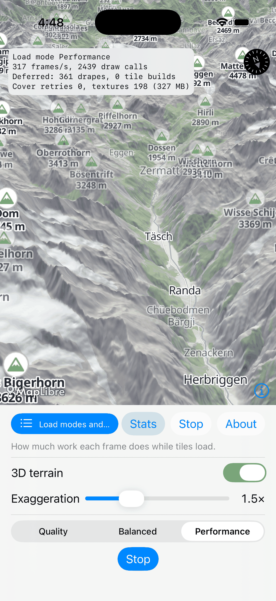
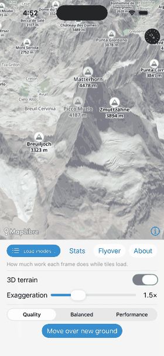

### 8. Restyle on terrain
Paint properties change at run time on layers that are already draped: basemap colors (Kit, Dusk, Sepia, Mono)
and the hillshade strength. The map does not move, and the drape updates under it.
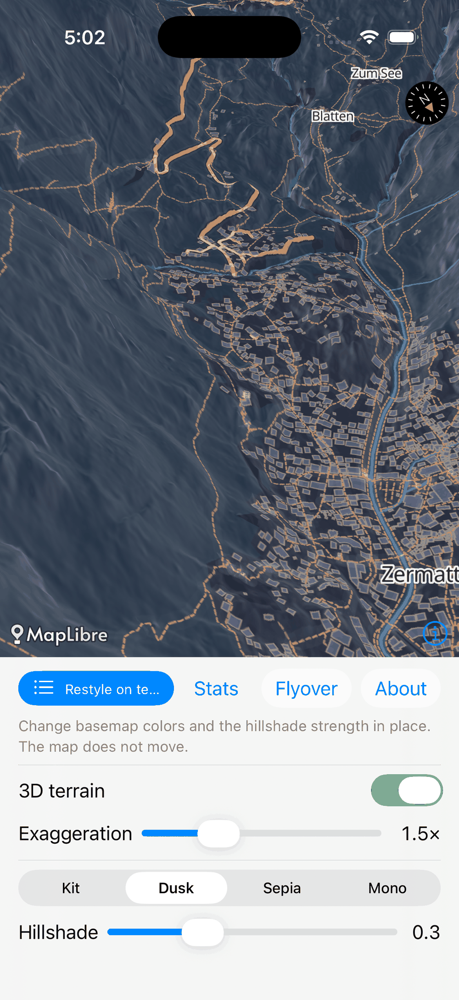
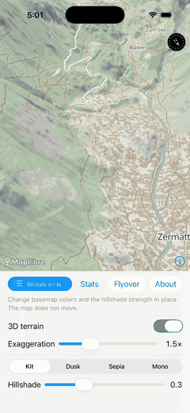

**Swapping a whole style did not work well**, so the example does not do it. Loading another OpenFreeMap style
(liberty, bright, positron) with `styleJSON` while terrain is on reloaded everything, and then the camera ended up
somewhere else, because the center height is worked out again from a terrain that has not loaded. When the camera was put
back, the ground did not draw at all and only the 3D buildings showed. The three styles themselves rendered fine
when the camera was left alone. This is a limit of the branch as tested here, not something the app can fix.

### 9. Camera follows the ground
A toggle for `MLNMapView.isCenterClampedToGround` and a pan from the valley up over the Gornergrat ridge at 2.5
exaggeration. With the clamp off the camera ends up inside the ridge and the map is blank. With it on the camera
stays above the ground. The GIF runs the same pan twice, off and then on.

| Clamp off | Clamp on |
|---|---|
| 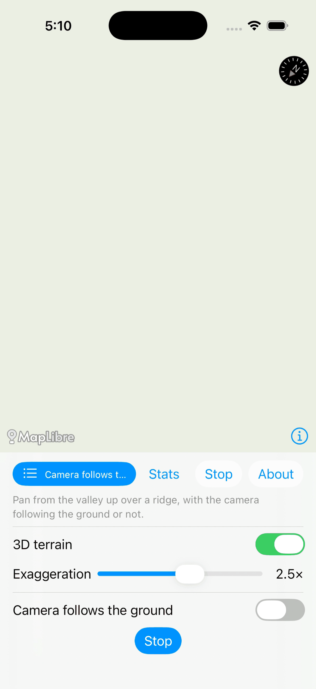 | 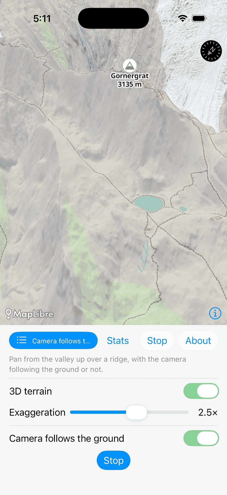 |

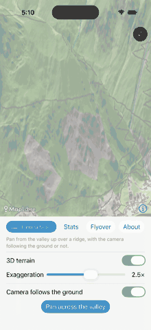

## Coming, not on this branch

These are open upstream pull requests and are **not** in `feature/terrain-3d`, so the app does not show them:

* distance haze;
* symbols fading with the haze;
* the camera eye staying above the ground (the clamp above is the closest thing today, and it is documented as
  experimental).

## Requirements

* Xcode 26.3 was used (iOS 26.3 simulator). The app is plain SwiftUI, but no other Xcode version was tried.
* iOS 15.5 or later: the deployment target is the MapLibre framework's. The app is for iPhone, in portrait.
* [Bazelisk](https://github.com/bazelbuild/bazelisk) (`brew install bazelisk`) to build the framework.

## 1. Build the framework

No public release contains the terrain branch yet, so the app links a local build of `MapLibre.xcframework`. The
file is git-ignored and never committed.

```sh
git clone --depth 1 --recurse-submodules --shallow-submodules --branch terrain-3d-examples \
  https://github.com/calibermaps/maplibre-native.git
cd maplibre-native
examples/terrain-3d/ios/build-framework.sh
```

The script is the iOS build recipe from `docs/mdbook/src/platforms/ios/README.md`, then a copy of the result to
`examples/terrain-3d/ios/MapLibre.xcframework`:

```sh
bazel build --compilation_mode=opt --features=dead_strip,thin_lto --objc_enable_binary_stripping \
  --apple_generate_dsym --//:renderer=metal //platform/ios:MapLibre.dynamic \
  --embed_label=maplibre_ios_"$(cat platform/ios/VERSION)"
unzip "$(bazel info --compilation_mode=opt bazel-bin)/platform/ios/MapLibre.dynamic.xcframework.zip"
cp -R MapLibre.xcframework examples/terrain-3d/ios/
```

The `terrain-3d-examples` branch contains upstream `feature/terrain-3d` at `08bad010482b` plus this kit, so the
framework is built from the branch exactly, with no changes. The first build takes about ten minutes, and the
framework is about 600 MB (device and simulator slices).

## 2. Run

Open `examples/terrain-3d/ios/TerrainExample.xcodeproj` in Xcode, choose an iPhone simulator and press Run. The
project has no team set and needs no run script, so it runs on the simulator as it is. For a device, set your team
under Signing and Capabilities. From a terminal:

```sh
xcodebuild -project examples/terrain-3d/ios/TerrainExample.xcodeproj -scheme TerrainExample \
  -sdk iphonesimulator -destination 'generic/platform=iOS Simulator' build
```

## How the pictures were made

The simulator was driven from a script with no mouse, so the app reads launch arguments. `-demo <id>` opens a demo
(`peaks`, `relief`, `buildings`, `overlays`, `occlusion`, `heat`, `sky`, `loadModes`, `restyle`, `clamp`), and
`-sub <name>` then does one more thing after the map loads (for example `sweep`, `tap-peak`, `modes-compare`,
`clamp-compare`; the list is in `MapController.swift`). The tap states call the same function a finger tap does,
with a fixed screen point. A normal launch ignores both. The pictures are `xcrun simctl io screenshot` and
`recordVideo` on an iPhone 17 Pro simulator, and the GIFs were cut from the recordings with AVFoundation and
Pillow.

## Files

| File | What it does |
|---|---|
| `TerrainExample/TerrainExampleApp.swift` | App entry point |
| `TerrainExample/ContentView.swift` | The Demos menu, the controls, the tap callout and the stats overlay |
| `TerrainExample/TerrainMapView.swift` | `UIViewRepresentable` around `MLNMapView` |
| `TerrainExample/MapController.swift` | Terrain, layer switches, taps, camera tours, stats, the launch scripts |
| `TerrainExample/Demo.swift` | The demos and their cameras, the color themes, the style merge |
| `TerrainExample/AboutView.swift` | The credits |
| `TerrainExample/style.json` | The basemap: OpenFreeMap vector tiles, the kit's example 3 |
| `TerrainExample/extras.json` | The sources and layers every demo uses, hidden until a demo turns them on |

The app joins `style.json` and `extras.json` into one style at launch. The hillshade, color relief and overlays
go under the labels so they are draped, and the elevated layers (symbols, circles, heatmap, extrusions) go on top.
Terrain is not in the JSON: the app sets `MLNStyle.terrain` in code once the style has loaded.

Three details:

* OpenMapTiles `transportation` tiles have no road names, so the style draws `transportation_name` as a nearly
  invisible line (opacity 0.02) that taps can read.
* OpenFreeMap's tile JSON says "Data from OpenStreetMap" and replaces the style's own attribution text. To show
  "© OpenStreetMap contributors" in the attribution button, the style declares an extra vector source,
  `osm-credit`, that no layer uses and that never requests tiles. The button lists only tile sources.
* `MLNMapView.isCenterClampedToGround` is on, so the camera stays above the mountain when it tilts. Without it the
  first frame at Zermatt (1,600 m) starts inside the ground.

## Known limits

From `TERRAIN.md` on the branch, and from what was seen while making the app.

* Labels along lines are not elevated, so the style has only point labels (places and peaks).
* The pitch is limited to 60 degrees, so there is no horizon in view.
* A slider change builds a new terrain object and redraws every tile, so the sliders apply their value when the
  finger lifts.
* The flyover turns from high up, but the camera still passes close to the ground on one frame, and the app does
  not check clearance.
* Skirts Auto against None, and swapping a whole style, are described above.
* Patterns, custom layers and the Android and desktop builds are not used. This is simulator only: nothing was run on
  a device and nothing was timed.

## Data and credits

No key or account is needed. Please keep your use light: these are free community services.

* **Map data:** © OpenStreetMap contributors, under the
  [Open Database License](https://www.openstreetmap.org/copyright).
* **Vector tiles, fonts and icons:** [OpenFreeMap](https://openfreemap.org)
  (`https://tiles.openfreemap.org/planet`), © [OpenMapTiles](https://www.openmaptiles.org/) schema.
* **Elevation:** [Mapterhorn](https://mapterhorn.com/attribution) via `https://tiles.mapterhorn.com/tilejson.json`,
  Terrarium encoding. The tiles are built from national and regional datasets: around Zermatt swissALTI3D from the
  Federal Office of Topography swisstopo, around Innsbruck data from Austria's BEV, in Yosemite the USGS 3D Elevation
  Program, elsewhere Copernicus GLO-30. Mapterhorn's attribution page lists every source, and the app's About
  screen links to it.
* **Overlays:** the zones, routes and waypoints in the overlay demo are made up for this example.
* **Software:** [MapLibre Native](https://github.com/maplibre/maplibre-native), © MapLibre contributors,
  BSD-2-Clause license.

The Swift code and the style files in this folder are original to this kit and fall under the repository's license.
