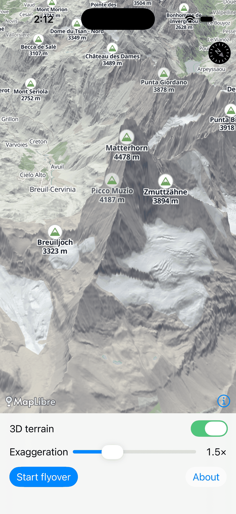
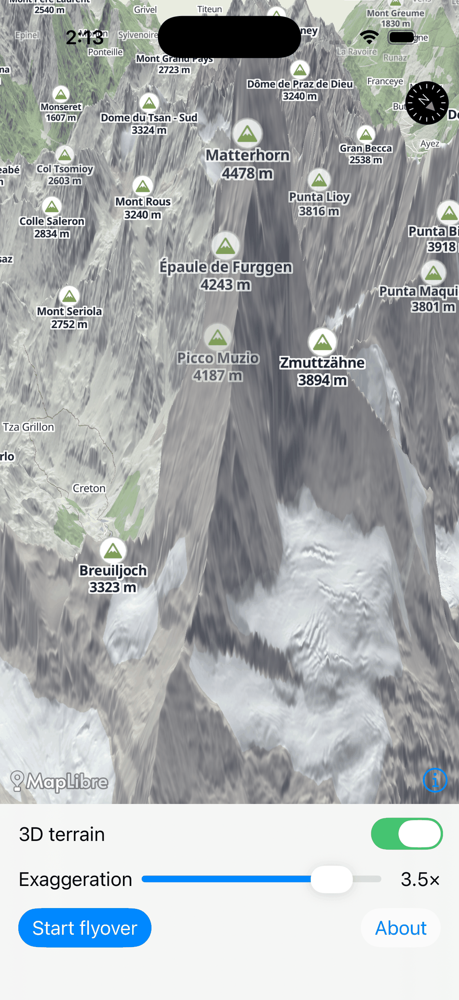
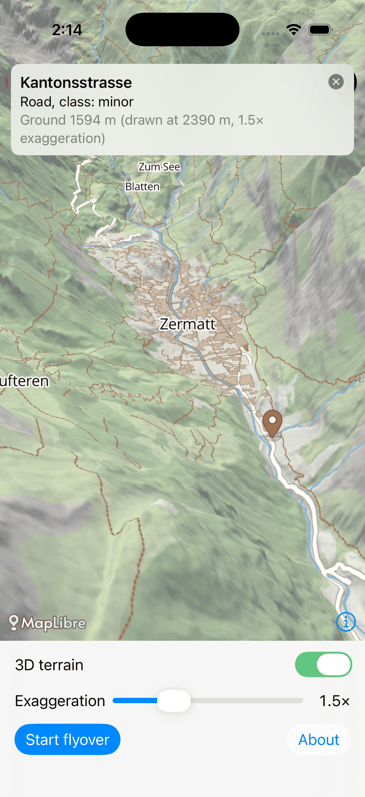

# Terrain 3D for iOS

A small SwiftUI app that shows the 3D terrain of the `feature/terrain-3d` branch of MapLibre Native on iOS.
The scene is the Matterhorn and Zermatt in the Swiss Alps. The app is five Swift files and one style file,
and it uses public data with no API key.

| 2D | 3D |
|---|---|
|  |  |

* **2D and 3D.** The switch sets `MLNStyle.terrain` and tilts the camera between 0 and 60 degrees.
* **Exaggeration.** A slider sets the terrain's vertical exaggeration, from 0.5 to 4.
* **Basemap.** The OpenFreeMap vector basemap is draped on the terrain: land cover, water, roads with
  casings, paths, buildings, place labels and a light hillshade from the same elevation data.
* **Peaks.** Peak symbols with name and height from the OpenMapTiles `mountain_peak` layer stand on the
  ground.
* **Taps.** Tap a peak or a road and the app reads `visibleFeatures(at:)` for its name and class. It always
  shows the ground height at the tap point from `MLNMapView.terrainElevation(at:)`.
* **Flyover.** A button runs a scripted camera tour down the Mattertal toward Täsch and back, with changes
  of pitch and bearing, using `setCamera(_:withDuration:animationTimingFunction:completionHandler:)`.
* **About.** The data credits and the MapLibre license note. The map's own attribution button (i) lists the
  sources too.

| Exaggeration 3.5 | Tap on a peak | Tap on a road |
|---|---|---|
|  |  |  |

| About | Attribution button |
|---|---|
|  |  |

2D and 3D switch (3D to 2D and back):


Flyover:


The ground height in the tap callout is the true height. `terrainElevation(at:)` returns the height as drawn,
with the exaggeration applied, so the app divides the exaggeration out and shows both. The tap on the
Matterhorn reads about 4,300 m, below the listed 4,478 m, because the tap lands near the summit and not exactly on it.

## Requirements

* Xcode 26.3 was used (iOS 26.3 simulator). The app uses plain SwiftUI, so older Xcode versions that can
  build the framework should work, but nothing else was tried.
* iOS 15.5 or later: the deployment target is the same as the MapLibre framework's. The app is for iPhone,
  in portrait.
* [Bazelisk](https://github.com/bazelbuild/bazelisk) (`brew install bazelisk`) to build the framework.

## 1. Build the framework

No public release contains the terrain branch yet, so the app links a local build of
`MapLibre.xcframework`. The file is git-ignored and never committed.

```sh
git clone --recurse-submodules --branch terrain-3d-examples https://github.com/calibermaps/maplibre-native.git
cd maplibre-native
examples/terrain-3d/ios/build-framework.sh
```

That script is the iOS build recipe from `docs/mdbook/src/platforms/ios/README.md`, then a copy of the
result to `examples/terrain-3d/ios/MapLibre.xcframework`:

```sh
bazel build --compilation_mode=opt --features=dead_strip,thin_lto --objc_enable_binary_stripping \
  --apple_generate_dsym --//:renderer=metal //platform/ios:MapLibre.dynamic \
  --embed_label=maplibre_ios_"$(cat platform/ios/VERSION)"
unzip "$(bazel info --compilation_mode=opt bazel-bin)/platform/ios/MapLibre.dynamic.xcframework.zip"
cp -R MapLibre.xcframework examples/terrain-3d/ios/
```

The `terrain-3d-examples` branch contains upstream `feature/terrain-3d` at `08bad010482b` plus this kit, so
the framework is built from the branch exactly, with no changes. To build from your own checkout of
`feature/terrain-3d` instead, run the script from there with this folder copied in. The first build takes
about ten minutes and the framework is about 600 MB (device and simulator slices).

## 2. Run

Open `examples/terrain-3d/ios/TerrainExample.xcodeproj` in Xcode, choose an iPhone simulator and press Run.
The project has no team set and needs no run script, so it runs on the simulator as it is. To run on a
device, set your team under Signing and Capabilities.

From a terminal:

```sh
xcodebuild -project examples/terrain-3d/ios/TerrainExample.xcodeproj -scheme TerrainExample \
  -sdk iphonesimulator -destination 'generic/platform=iOS Simulator' build
```

## How the pictures were made

The simulator was driven with launch arguments, because the pictures were taken from a script with no mouse.
`-demo <name>` puts the app in one state after the map loads: `2d-3d`, `exaggeration`, `tap-peak`,
`tap-road`, `about`, `attribution` or `flyover`. The tap states call the same function a finger tap does,
with a fixed screen point. A normal launch ignores the argument. The pictures were recorded with
`xcrun simctl io <device> screenshot` and `recordVideo` on an iPhone 17 Pro simulator.

## Files

| File | What it does |
|---|---|
| `TerrainExample/TerrainExampleApp.swift` | The app entry point |
| `TerrainExample/ContentView.swift` | The controls, the tap callout and the About sheet |
| `TerrainExample/TerrainMapView.swift` | `UIViewRepresentable` around `MLNMapView` |
| `TerrainExample/MapController.swift` | Terrain switch, exaggeration, taps, flyover, the `-demo` states |
| `TerrainExample/AboutView.swift` | The credits |
| `TerrainExample/style.json` | The style: OpenFreeMap basemap, Mapterhorn elevation, peaks |

The style is the vector basemap of example 3 in this kit, with a `mountain_peak` symbol layer and a faint
road-name line layer added. Terrain is not in the JSON: the app sets `MLNStyle.terrain` in code once the
style has loaded, and uses its own `raster-dem` source for it, apart from the hillshade's, as the
`MLNTerrain` documentation recommends.

Two details worth knowing:

* `transportation` tiles in the OpenMapTiles schema have no road names. The names are in
  `transportation_name`, so the style draws that layer as a nearly invisible line (opacity 0.02) that taps
  can read.
* OpenFreeMap's tile JSON says "Data from OpenStreetMap" and replaces the style's own attribution text. To
  show "© OpenStreetMap contributors" in the attribution button, the style declares an extra vector source,
  `osm-credit`, that no layer uses. The map never requests tiles from it. The attribution button lists
  only tile sources, so it has to be one.
* `MLNMapView.isCenterClampedToGround` is on, so the camera stays above the mountain when it tilts. Without
  it the first frame at Zermatt (1,600 m) starts inside the ground.

## Known limits

These come from `TERRAIN.md` on the branch and from what was seen while making the app.

* Labels along lines are not elevated: the CPU-placed labels along a line do not follow the terrain yet.
  The style has no line labels, only point symbols (places and peaks).
* Fill-extrusion buildings are not used. `TERRAIN.md` marks the Metal column as awaiting CI confirmation.
* Heatmaps, patterns and custom layers are not used, because `TERRAIN.md` lists them as unfinished.
* The feature is marked experimental, and `isCenterClampedToGround` is documented as subject to change.
* The pitch is limited to 60 degrees on iOS, so the app cannot look flatter at the horizon than that.
* A slider change builds a new terrain object and redraws every tile, so the app applies the value when the
  finger lifts, not while dragging.
* The flyover turns around a high point so the camera stays above the ridge. On a steeper route the
  camera can still pass close to the ground, and this app does not check the clearance.
* Only the simulator was used. The app has not been run on a device, and no speed measurements were taken.

## Data and credits

No key or account is needed. Please keep your use light: these are free community services.

* **Map data:** © OpenStreetMap contributors, under the
  [Open Database License](https://www.openstreetmap.org/copyright).
* **Vector tiles, fonts and icons:** [OpenFreeMap](https://openfreemap.org)
  (`https://tiles.openfreemap.org/planet`), © [OpenMapTiles](https://www.openmaptiles.org/) schema.
* **Elevation:** [Mapterhorn](https://mapterhorn.com/attribution) via
  `https://tiles.mapterhorn.com/tilejson.json`, Terrarium encoding. Around Zermatt the tiles are built
  from swissALTI3D by the Federal Office of Topography swisstopo. Mapterhorn's attribution page lists every
  source dataset it uses, and the app's About screen links to it.
* **Software:** [MapLibre Native](https://github.com/maplibre/maplibre-native), © MapLibre contributors,
  BSD-2-Clause license.

The Swift code and the style in this folder are original to this kit and fall under the repository's license.
